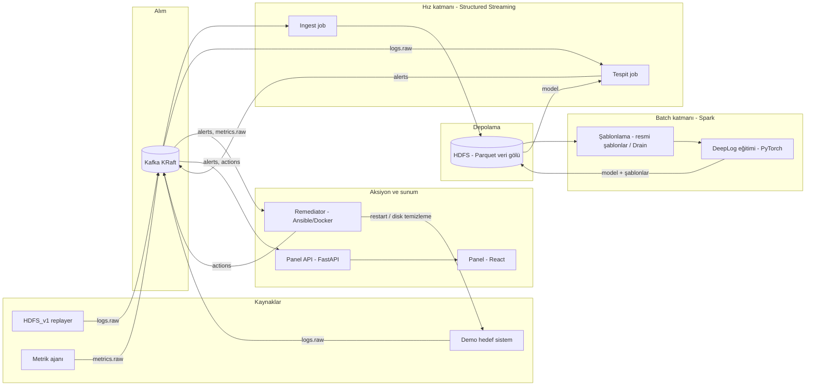
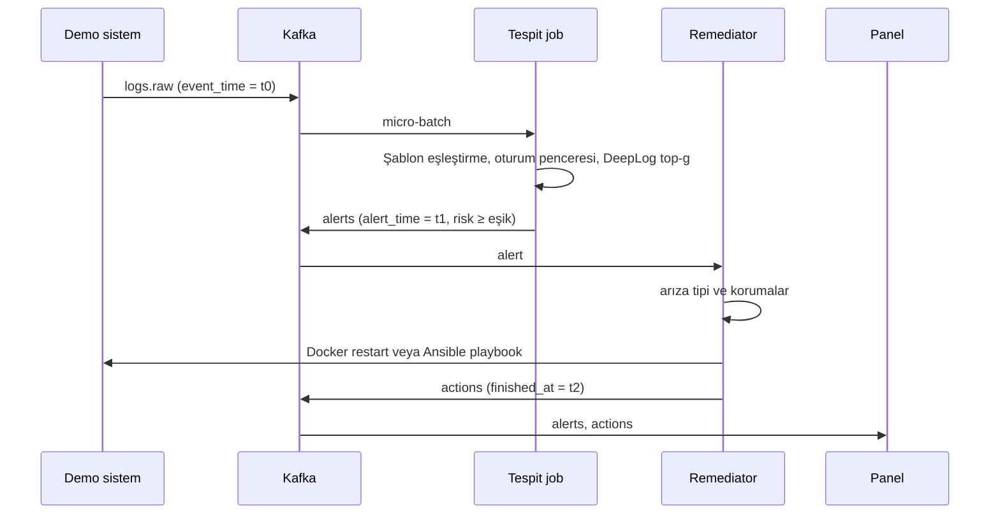

# Mimari

## 1. Genel bakış

Sistem Lambda mimarisi üzerine kuruludur ([ADR-0001](adr/0001-lambda-mimarisi.md)):

- **Batch katmanı**, HDFS'teki geçmiş veriden log şablonlarını ve modeli üretir.
- **Hız katmanı**, Kafka'dan gelen canlı akışı bu modelle skorlar.
- **Aksiyon ve sunum katmanı**, alarmlara göre otonom müdahale eder ve sonuçları panelde gösterir.



## 2. Bileşenler

| Bileşen | Teknoloji | Sorumluluk | Epic |
|---|---|---|---|
| Kafka | Apache Kafka, KRaft modu, tek broker | Tüm olayların omurgası | INF |
| HDFS | Hadoop 3, 1 NameNode + 1 DataNode | Veri gölü, model deposu, streaming checkpoint'leri | INF |
| Spark | Spark 4.2.1 ([ADR-0007](adr/0007-spark-4-ve-python-310.md)), 1 master + 1 worker. Özel imajda Kafka bağlayıcısı, PyTorch CPU, drain3, pandas ve pyarrow bulunur | Batch ve streaming işleri | INF |
| Replayer | Python | HDFS_v1 loglarını ayarlanabilir hızla Kafka'ya basar | ING |
| Metrik ajanı (`metrics-agent`) | Python, Docker Engine API (salt okuma vekili `socket-proxy` üzerinden) | Projedeki konteynerlerin CPU, bellek, disk G/Ç ve ağ ölçümlerini 5 sn'de bir toplar. Demo sistemin `/health` çıktısındaki disk doluluğu REM-01 ile eklenecek | ING, REM |
| Ingest job (`spark-ingest`) | Structured Streaming | `logs.raw` topic'ini HDFS raw bölgesine Parquet olarak yazar, sözleşmeye uymayanları karantinaya ayırır. `metrics.raw` ve `actions` topic'leri ING-05 ve REM ile eklenecek | ING |
| Şablonlama job | Spark batch (`mapInPandas`): HDFS_v1 için resmi Loghub şablon eşleştiricisi, demo sistem için Drain3 ([ADR-0008](adr/0008-sablon-kaynagi.md)) | Ham logları şablon kimliğine (`template_id`) çevirir; şablon sözlüğünü üretir | ML |
| DeepLog eğitimi | PyTorch (tek düğüm) | Model eğitimi ve değerlendirmesi | ML |
| Tespit job | Structured Streaming, `applyInPandasWithState` | Oturum bazlı risk skoru üretir, eşik aşılınca alarm yazar | RT |
| Remediator | Python, Ansible, Docker SDK (ayrı konteyner) | Alarmdan arıza tipini çıkarır, korumaları uygular ve aksiyonu çalıştırır | REM |
| Demo hedef sistem | Küçük bir FastAPI uygulaması ve arıza enjektörü | Otonom döngünün denendiği canlı sistem | REM |
| Panel | FastAPI (WebSocket) + React | Canlı akış, alarmlar, aksiyonlar ve KPI'lar | UI |

## 3. Veri akışları

### 3.1 Hız yolu (anomali → aksiyon)



Bu akıştaki zaman damgalarından iki KPI hesaplanır: K5 = t1 − t0 ve K6 = t2 − t1.

### 3.2 Batch yolu

1. Ingest job ham logları sürekli olarak `raw` bölgesine yazar.
2. Şablonlama job'u (elle ya da günlük çalışır) her kayda `template_id` ekleyerek `curated/events` bölgesini ve `templates.json` sözlüğünü üretir.
3. Kayıtlar oturumlara ayrılır. HDFS_v1'de oturum anahtarı `block_id`'dir; demo sistemde servis adı ve kayan pencere kullanılır.
4. DeepLog eğitilir ve çıktısı `models/deeplog/<iz>-vN/` altına yazılır: ağırlıklar, şablon sözlüğü, eşik ve metrikler.
5. Tespit job'u yeni model sürümünü yeniden başlatıldığında yükler. Çalışma sırasında model değiştirme (hot-swap) yoktur.

Şablon eşleştirme ve skor hesaplama kodu tek bir modülde durur ve hem batch hem hız yolu bu modülü çağırır. Böylece eğitimdeki skorla canlı skor birbirinden sapmaz (testi RT-05).

## 4. Kafka topic'leri

| Topic | Üretici | Tüketici | Anahtar | Bölüm | Saklama |
|---|---|---|---|---|---|
| `logs.raw` | Replayer, demo sistem | Ingest, Tespit | `session_key` (yoksa `source`) | 3 | 24 sa |
| `metrics.raw` | Metrik ajanı | Ingest, Remediator | `source` | 1 | 24 sa |
| `alerts` | Tespit job | Remediator, Panel API | `source` | 1 | 7 gün |
| `actions` | Remediator | Ingest, Panel API | `source` | 1 | 7 gün |

Saklama süresi dolup silinmiş offset'lerde ingest akışları farklı davranır: `logs.raw` (ana veri, K2) durur ve elle karar bekler; `metrics.raw` (telemetri) uyarıyla en eski mevcut offset'ten devam eder (risk R-14).

`logs.raw` topic'inin anahtarı `session_key`'dir. Bunun iki nedeni var: Bir oturumun olayları aynı bölüme düşer ve sırası korunur, ki DeepLog dizi modeli bu sıraya dayanır. Ayrıca HDFS_v1'deki 575 bin oturum üç bölüme dengeli dağılır. `source` anahtar olsaydı tüm HDFS logları tek bölüme giderdi (ING-03'te ölçülen dağılım: 99.567 / 98.533 / 101.900).

## 5. Veri sözleşmeleri

Tüm mesajlar UTF-8 JSON'dur ve bir `schema_version` alanı taşır. Şemalar ING-02 kapsamında kodda tanımlanır ve doğrulanır.

**`logs.raw`**

```json
{"schema_version": 1, "id": "uuid", "source": "hdfs-replay", "session_key": "blk_-1608999687919862906",
 "event_time": "2026-11-23T10:15:30.123Z", "level": "INFO",
 "message": "Receiving block blk_-1608999687919862906 src: /10.250.19.102:54106 dest: /10.250.19.102:50010",
 "label": null}
```

`label` alanı yalnızca replayer tarafından doldurulur ve yalnızca deney değerlendirmesinde kullanılır. **Tespit job'u bu alanı okumaz.** Kural bir birim testiyle güvence altındadır (RT-05).

`source` alanı verinin kökenini ayırır. `hdfs-replay` değeri, HDFS_v1'in ML için **bir kez** yapılan kanonik oynatmasına aittir (ING-10); ML işleri yalnızca bu kaynağı okur. Testler ve deneyler kendi kaynak adlarını kullanır (`ingest-test`, `exp01-r<hız>-<tekrar>-<zaman>`). Aynı HDFS_v1 satırları bu koşularda tekrar tekrar oynatıldığından, ayrım yapılmazsa aynı blok farklı koşulardaki kopyalarla tek oturumda birleşir ve eğitim verisi bozulur.

**`metrics.raw`**

```json
{"source": "kafka", "event_time": "2026-11-18T12:34:43.824Z", "mem_bytes": 465309696,
 "mem_limit_bytes": 1073741824, "blk_read_bytes": 0, "blk_write_bytes": 17850368,
 "net_rx_bytes": 377278, "net_tx_bytes": 31344713, "cpu_pct": 12.5, "healthy": true,
 "disk_used_pct": null, "schema_version": 1}
```

Bayt alanları sayaçtır, yani konteyner başladığından beri biriken toplamı tutar. Oranlar ardışık iki ölçümün farkından hesaplanır. `cpu_pct` değerinde 100 bir çekirdeğin tam dolu olduğunu gösterir; ilk ölçümde önceki örnek olmadığı için boştur. Kafka mesaj anahtarı `source`'tur (servis adı).

**`alerts`**

```json
{"schema_version": 1, "alert_id": "uuid", "source": "demo-app", "session_key": "...",
 "risk_score": 0.91, "threshold": 0.85, "trigger_event_time": "...", "alert_time": "...",
 "model_version": "deeplog-demo-v1", "evidence": {"unexpected_templates": ["T42"], "unknown_count": 2}}
```

**`actions`**

```json
{"schema_version": 1, "action_id": "uuid", "alert_id": "uuid", "source": "demo-app",
 "fault_type": "disk_full", "action": "ansible:disk_cleanup", "dry_run": false,
 "status": "success", "started_at": "...", "finished_at": "...", "detail": "..."}
```

Alanların alabileceği değerler:

- `fault_type`: `disk_full`, `service_unresponsive`, `unknown`
- `action`: `ansible:disk_cleanup`, `docker:restart`, `none`
- `status`: `success`, `failed`, `skipped_cooldown`, `skipped_duplicate`, `skipped_not_allowlisted`, `skipped_disabled`

## 6. HDFS düzeni

```
/datalake/raw/logs/date=YYYY-MM-DD/hour=HH/*.parquet
/datalake/raw/metrics/date=YYYY-MM-DD/*.parquet
/datalake/raw/actions/date=YYYY-MM-DD/*.parquet
/datalake/quarantine/logs/date=YYYY-MM-DD/*.parquet          (sözleşmeye uymayan kayıtlar: ham değer + neden)
/datalake/curated/events/source=<kaynak>/date=YYYY-MM-DD/   (template_id eklenmiş)
/datalake/views/daily_summary/                              (panel için batch görünümü)
/models/deeplog/<iz>-vN/{model.pt, templates.json, config.yaml, metrics.json}
/checkpoints/<job>/                                         (Structured Streaming checkpoint'leri)
```

`raw/logs` satırları `LogEvent` alanlarının yanında Kafka konumunu (`kafka_partition`, `kafka_offset`, `kafka_timestamp`) ve `ingest_time` alanını taşır. Kayıp ve tekrar denetimi (`jobs/verify_ingest.py`) bu konum üzerinden yapılır. Bölgeler Structured Streaming dosya hedefiyle yazılır; okuyucular dizin kökünü okumalıdır. Böylece yalnızca `_spark_metadata` günlüğüne işlenmiş dosyalar görülür, yarım kalan bir micro-batch'in dosyaları görülmez.

## 7. Servisler, portlar ve kaynak bütçesi

Geliştirme makinesinde 32 GB RAM var. WSL2 12 GB bellek ve 6 çekirdekle sınırlanmıştır (INF-01). Uzun çalışan servislerin RAM limitlerinin toplamı 10 GB'ı geçemez. Tüm portlar yalnızca `127.0.0.1` adresine bağlanır. Bu kuralların ikisi de [tests/test_compose.py](../tests/test_compose.py) tarafından denetlenir.

| Servis | Host portu | RAM limiti |
|---|---|---|
| kafka | 9092 | 1 GB |
| namenode | 9870 (UI) | 1 GB |
| datanode | 9864 (UI) | 1 GB |
| spark-master | 8080 (UI), 7077 | 512 MB |
| spark-worker | 8081 (UI) | 3 GB |
| spark-ingest (sürekli sürücü) | 4040 (UI) | 1 GB |
| spark-job (geçici sürücü) | – | 1 GB |
| remediator | – | 256 MB |
| demo-app | 8000 | 256 MB |
| panel-api | 8001 | 256 MB |
| socket-proxy | – | 64 MB |
| metrics-agent | – | 128 MB |
| **Toplam** | | **~9,5 GB** |

Worker 2 çekirdek ve 2 GB executor belleği sunar. Her Spark uygulaması 1 çekirdek ve 1 GB ile sınırlıdır (`spark.cores.max`); bu sayede sürekli çalışan `spark-ingest`'in yanında aynı anda bir `spark-job` daha çalışabilir. Docker Compose profilleriyle yalnızca o anki iş için gereken servisler açılır. Örneğin model eğitimi sırasında panel ve demo sistem kapalı tutulur.

## 8. Ortamlar

| Ortam | Amaç | Nasıl |
|---|---|---|
| local | Geliştirme ve deneyler | Tek makinede Docker Compose |
| CI | Lint ve birim testleri | GitHub Actions (konteyner gerektirmez) |
| cloud (B planı) | Donanım yetmezse | GCP veya AWS öğrenci kredisi, aynı compose dosyası |

## 9. Güvenlik notları

- Metrik ajanı Docker soketini doğrudan görmez. Araya konan `socket-proxy` yalnızca `GET /containers/*` isteklerine izin verir; başlatma, durdurma, yeniden başlatma ve `exec` 403 ile reddedilir (ING-05'te denendi). Ajan konteynerde root olmayan `nobody` kullanıcısıyla çalışır.
- Remediator Docker soketine erişir; bu, host üzerinde root yetkisine eşdeğerdir. Bu nedenle yalnızca allowlist'teki konteynerlere aksiyon alır ve laboratuvar dışında çalıştırılmaz (risk R-06).
- Sırlar (örneğin Slack webhook adresi) `.env` dosyasında tutulur. `.env` git'e girmez; depoya yalnızca `.env.example` konur.
- Aksiyonlar varsayılan olarak `DRY_RUN=true` modunda çalışır. `AUTOREMEDIATION_ENABLED=false` ayarı tüm aksiyonları anında durdurur (kill switch).

## 10. Hedef depo yapısı

Her klasör, ilgili iş kalemi başladığında oluşturulur.

```
DeepLog/
├── README.md
├── docs/                 # bu planlama belgeleri, ADR'ler, runbook'lar, aylık raporlar
├── infra/                # docker-compose.yml, .env.example, images/{spark,remediator}/
├── ingestion/            # replayer, metrik ajanı
├── jobs/                 # Spark batch ve streaming işleri
├── ml/                   # DeepLog, IF baseline, skor fonksiyonu, değerlendirme
├── remediation/          # remediator servisi, playbooks/
├── demo-target/          # demo uygulama, yük üreteci, arıza enjektörü
├── dashboard/            # api/ (FastAPI), web/ (React)
├── experiments/          # EXP-XX config'leri ve üretilen sonuçlar
├── tests/
└── data/                 # git dışında: indirilen veri setleri
```
