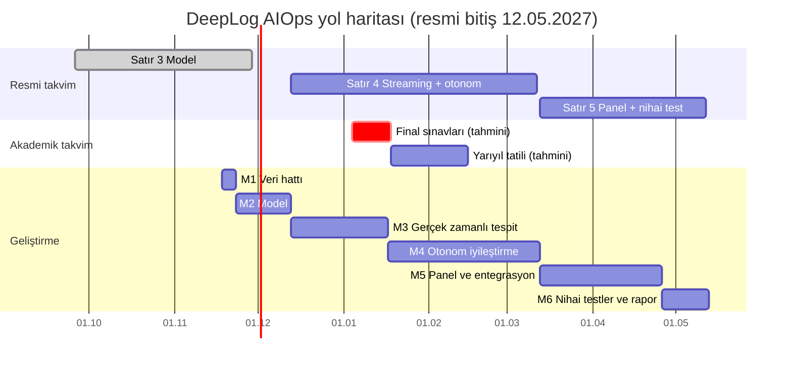

# Yol Haritası

> **18.11.2026'da yeniden planlandı.** Proje, kabul edilmiş ve desteklenen bir TÜBİTAK 2209-A projesidir. Resmi dönem **12.05.2026 – 12.05.2027**'dir. Aşağıdaki plan, kabul edilen önerideki çalışma takvimine (§1) uyacak şekilde kurulmuştur.

## 1. Resmi çalışma takvimi (kabul edilen öneri)

Bağlayıcı olan, aşağıdaki tablodaki başarı ölçütleridir. [Tüzük §4](00-proje-tuzugu.md#4-başarı-ölçütleri-kpi)'teki K1–K10 bunlardan daha sıkı iç hedeflerdir.

| Satır | Resmi tarih | Faaliyet | Formdaki başarı ölçütü | Katkı | Karşılığı | Durum |
|---|---|---|---|---|---|---|
| 1 | 12.05 – 14.07.2026 | Büyük veri altyapısının (Hadoop HDFS, Kafka) Docker üzerinde kurulumu | Hadoop ve Kafka servislerinin hatasız çalışması ve arayüzlerine erişilebilmesi | %10 | M0 | ✅ Kasım 2026'da yeniden kuruldu; dayanıklılık testleri dahil |
| 2 | 16.07 – 22.09.2026 | Log üretici ve Kafka entegrasyonu ile veri toplama hattı | Saniyede en az 1.000 log verisinin kayıpsız olarak HDFS'e aktarılması | %20 | M1 | ✅ Yeniden kuruldu. 2.000 log/sn'de kayıp 0 ölçüldü; EXP-01 tam ölçümü sürüyor |
| 3 | 26.09 – 29.11.2026 | Geçmiş veriler üzerinde anomali tespiti modelinin geliştirilmesi ve eğitilmesi | Test verisinde %85 üzeri Precision | %25 | M2 | 🔄 Sürüyor. Resmi bitişten yaklaşık 2 hafta sonra (12.12.2026) tamamlanması hedefleniyor |
| 4 | 13.12.2026 – 12.03.2027 | Spark Streaming ile canlı analiz ve Ansible ile otonom iyileştirme | Tespitten iyileştirme komutunun gönderilmesine kadar geçen süre < 1 dk | %25 | M3 + M4 | ⏳ |
| 5 | 13.03 – 12.05.2027 | Web paneli, modüllerin entegrasyonu ve nihai sistem testleri | Canlı veri akışının ve alarmların arayüzde gecikmesiz görüntülenmesi | %20 | M5 + M6 | ⏳ |

Önceki prototipte 1–3. satırların işleri yapılmıştı (arşivdeki `proje_plani.md`). Kasım 2026'da sistem, ölçülebilir hedefler ve testlerle sıfırdan yeniden kuruldu. Kabul edilen öneriden sapmalar ve gerekçeleri sonuç raporu için [docs/tubitak/](tubitak/oneri-guncellemeleri.md) altında tutulur (GOV-05).

## 2. Kilometre taşları

| ID | Ad | Tarih | Resmi satır | Çıkış kriteri | Sürüm |
|---|---|---|---|---|---|
| M0 | Temel | ✅ 17 – 18.11.2026 | 1 | Tüm servisler sağlıklı; duman testi ve arıza testleri yeşil | v0.1.0 |
| M1 | Veri hattı | 18 – 22.11.2026 | 2 | K1 ve K2 sağlandı (EXP-01); HDFS_v1 kanonik olarak bir kez oynatıldı (ING-10) | v0.2.0 |
| M2 | Model | 23.11 – 12.12.2026 | 3 | K3 ve K4 sağlandı (EXP-02). **Formdaki ölçüt olan Precision > %85 hem DeepLog hem Isolation Forest için raporlandı** | v0.3.0 |
| M3 | Gerçek zamanlı tespit | 13.12.2026 – 16.01.2027 | 4 | K5 sağlandı (EXP-03); offline ve streaming skorları birebir aynı | v0.4.0 |
| M4 | Otonom iyileştirme | 17.01 – 12.03.2027 | 4 | K6, K7 ve K8 sağlandı, K9 ölçüldü (EXP-04, EXP-05). Formdaki ölçüt: tespit → komut < 1 dk | v0.5.0 |
| M5 | Panel ve entegrasyon | 13.03 – 25.04.2027 | 5 | K10 sağlandı; E2E test yeşil | v1.0.0 |
| M6 | Nihai testler ve rapor | 26.04 – 12.05.2027 | 5 | Tüm KPI'lar tek koşuda yeniden üretildi; sonuç raporu, tez ve bildiri taslakları hazır | v1.0.x |

## 3. Sprint takvimi

Sprintler iki haftalıktır ve pazartesi başlar. 17–22.11.2026 arasında yapılan yeniden kurulum işleri S0 olarak sayılır. İş kalemlerinin sprint atamaları [Backlog](03-backlog.md)'tadır. Sınav ve tatil tarihleri tahminidir; Bartın Üniversitesi akademik takvimiyle doğrulanmalıdır.

| Sprint | Tarih | Kilometre taşı | Not |
|---|---|---|---|
| S0 | 17 – 22.11.2026 | M0, M1 | ✅ yeniden kurulum |
| S1 | 23.11 – 06.12.2026 | M1 kapanışı, M2 | |
| S2 | 07 – 20.12.2026 | M2 kapanışı (12.12), M3 başlangıcı | |
| S3 | 21.12.2026 – 03.01.2027 | M3 | Yılbaşı |
| S4 | 04 – 17.01.2027 | M3 kapanışı | Final sınavları: yarım kapasite |
| S5–S6 | 18.01 – 14.02.2027 | M4 | Yarıyıl tatili: tam kapasite |
| S7–S8 | 15.02 – 14.03.2027 | M4 kapanışı (12.03) | S8 tampon |
| S9–S11 | 15.03 – 25.04.2027 | M5 | Vize haftasına denk gelen sprintte yarım kapasite; S11 tampon |
| S12 | 26.04 – 12.05.2027 | M6 | Proje bitişi: 12.05.2027 |

## 4. Değişiklik yönetimi

- Kapsam ve KPI değişiklikleri önce [Tüzük](00-proje-tuzugu.md) üzerinde yapılır ve danışman onayı gerekir. Ardından bu belge ve backlog güncellenir.
- Teknoloji ya da yöntem değişikliği yeni bir ADR ile kayda geçer. **Kabul edilen öneriden sapan her değişiklik** ayrıca GOV-05 sapma kaydına işlenir.
- Bir kilometre taşı bir sprintten fazla kayarsa [Risk Kaydı](05-risk-kaydi.md)'ndaki R-08 devreye girer ve "Could" öncelikli işler kesilir. Resmi bitiş tarihi (12.05.2027) kaydırılamaz.
