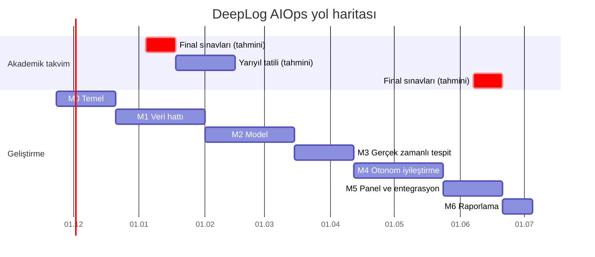

# Yol Haritası

## 1. Planlama varsayımları

- Sprintler iki haftalıktır ve pazartesi başlar. İlk sprint (S1) 2026-11-23'te başlıyor.
- Sprint kapasitesi dönem içinde 24 saat, sınav haftalarında 12 saat, tatillerde 40 saattir.
- Sınav ve tatil tarihleri tahminidir; Bartın Üniversitesi akademik takvimiyle doğrulanmalıdır.
- İş kalemleri ve sprint atamaları [Backlog](03-backlog.md) dosyasındadır.

## 2. Kilometre taşları

| ID | Ad | Sprintler | Tarih | Çıkış kriteri | Sürüm |
|---|---|---|---|---|---|
| M0 | Temel | S1–S2 | 23.11.2026 – 20.12.2026 | GOV ve INF epic'leri tamam; `docker compose up` ile tüm servisler sağlıklı; smoke test yeşil; TÜBİTAK formu bu plana göre güncellendi | v0.1.0 |
| M1 | Veri hattı | S3–S5 | 21.12.2026 – 31.01.2027 | K1 ve K2 sağlandı (EXP-01 raporu) | v0.2.0 |
| M2 | Model | S6–S8 | 01.02.2027 – 14.03.2027 | K3 ve K4 sağlandı (EXP-02 raporu); model v1 HDFS'te | v0.3.0 |
| M3 | Gerçek zamanlı tespit | S9–S10 | 15.03.2027 – 11.04.2027 | K5 sağlandı (EXP-03); offline ve streaming skorları birebir aynı | v0.4.0 |
| M4 | Otonom iyileştirme | S11–S13 | 12.04.2027 – 23.05.2027 | K6, K7 ve K8 sağlandı; K9 ölçüldü (EXP-04, EXP-05) | v0.5.0 |
| M5 | Panel ve entegrasyon | S14–S15 | 24.05.2027 – 20.06.2027 | K10 sağlandı; E2E test yeşil; tüm KPI'lar tek koşuda yeniden üretildi | v1.0.0 |
| M6 | Raporlama | S16 | 21.06.2027 – 04.07.2027 | Deney raporu, tez taslağı ve bildiri taslağı hazır | – |

## 3. Sprint kapasitesi

| Sprint | Tarih | Kapasite | Not |
|---|---|---|---|
| S1–S3 | 23.11.2026 – 03.01.2027 | 24 sa/sprint | Dönem içi |
| S4 | 04.01.2027 – 17.01.2027 | 12 sa | Final sınavları |
| S5–S6 | 18.01.2027 – 14.02.2027 | 40 sa/sprint | Yarıyıl tatili |
| S7–S14 | 15.02.2027 – 06.06.2027 | 24 sa/sprint | Dönem içi; vize haftasına denk gelen sprintte 12 sa |
| S15 | 07.06.2027 – 20.06.2027 | 12 sa | Final sınavları |
| S16 | 21.06.2027 – 04.07.2027 | 40 sa | Yaz |

## 4. TÜBİTAK çalışma takvimi eşlemesi

Başvuru formundaki Çalışma Takvimi tablosu aşağıdaki satırlardan doldurulur. Ay numaraları TÜBİTAK proje başlangıç tarihine göredir; somut tarihler destek sözleşmesi imzalandığında yazılır. Başarı ölçütü sütunu yalnızca [KPI tablosuna](00-proje-tuzugu.md#4-başarı-ölçütleri-kpi) atıf yapar, böylece formdaki sayılar birbirleriyle çelişmez.

| Form satırı | Faaliyet | Ay | Başarı ölçütü | Katkı |
|---|---|---|---|---|
| 1 | Büyük veri altyapısının (Kafka KRaft, HDFS, Spark) Docker üzerinde kurulumu | 1–2 | Tüm servislerin sağlık kontrollerinden geçmesi ve uçtan uca smoke testin başarılı olması | %10 |
| 2 | Log replayer, metrik ajanı ve Structured Streaming ile Kafka'dan HDFS'e (Parquet) veri toplama hattı | 2–4 | K1 ve K2 | %15 |
| 3 | Drain ile log şablonlama, DeepLog modelinin geliştirilmesi, Isolation Forest ile karşılaştırma | 4–7 | K3 ve K4 | %25 |
| 4 | Structured Streaming ile gerçek zamanlı tespit ve Ansible/Docker tabanlı otonom iyileştirme | 7–10 | K5–K8; K9 ölçülür | %30 |
| 5 | Web paneli, tüm modüllerin entegrasyonu ve nihai sistem testleri | 10–12 | K10 ve tüm KPI'ların uçtan uca koşuda yeniden üretilmesi | %20 |

Başvuru tarihinde tamamlanmış işler formun **Ön Çalışma** bölümüne yazılır ve takvimden çıkarılır. Bu durumda katkı yüzdeleri, toplamı 100 olacak şekilde yeniden dağıtılır.

## 5. Değişiklik yönetimi

- Kapsam ve KPI değişiklikleri önce [Tüzük](00-proje-tuzugu.md) üzerinde yapılır ve danışman onayı gerekir. Ardından bu belge ve backlog güncellenir.
- Teknoloji ya da yöntem değişikliği yeni bir ADR ile kayda geçer.
- Bir kilometre taşı iki sprintten fazla kayarsa [Risk Kaydı](05-risk-kaydi.md)'ndaki R-08 devreye girer ve "Could" öncelikli işler kesilir.
